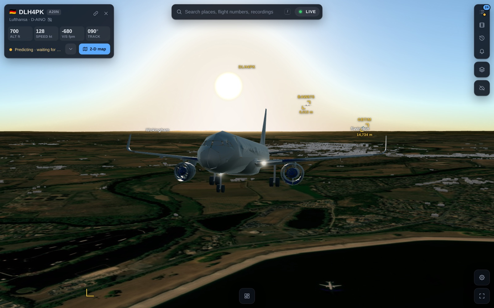
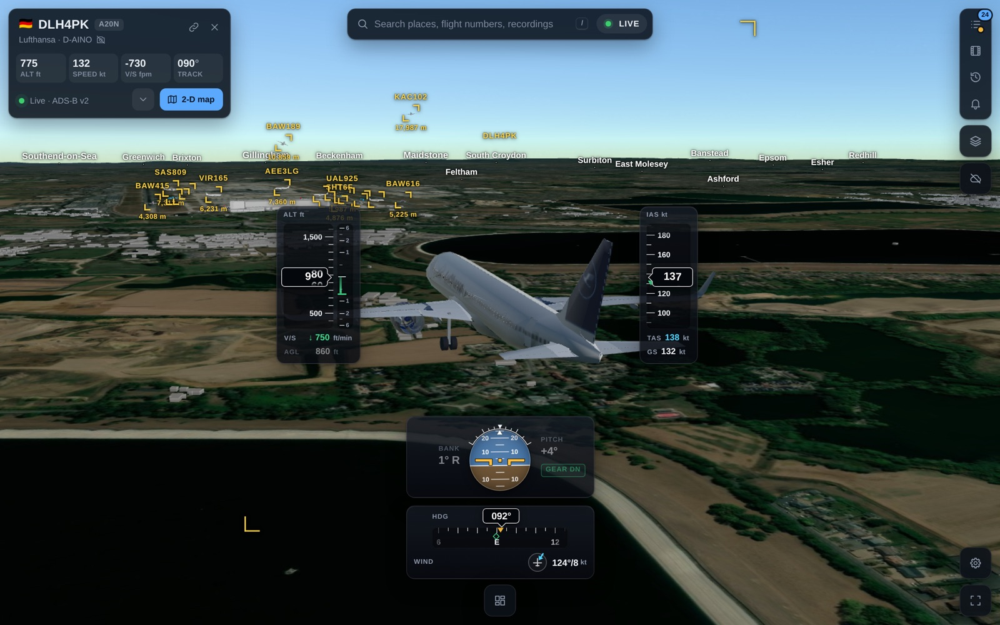
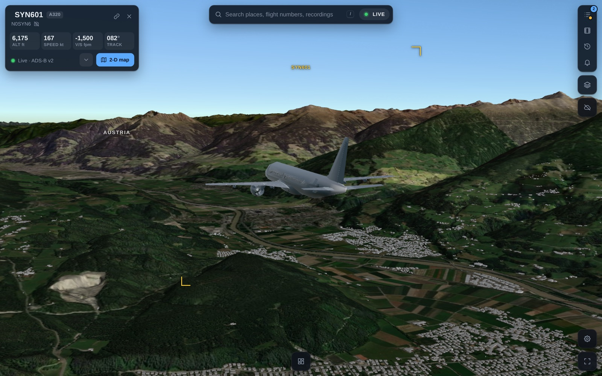
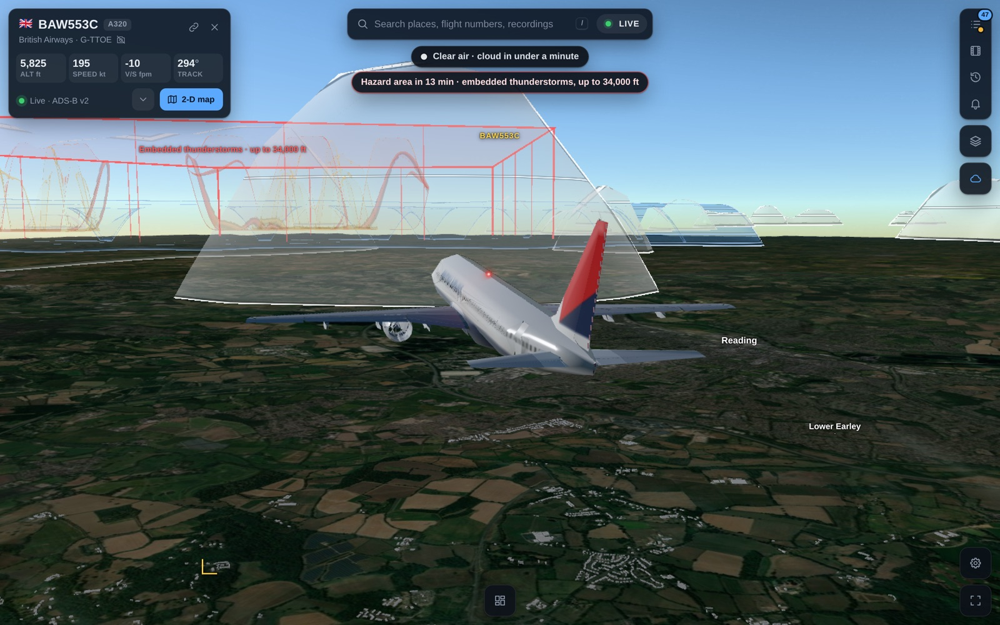
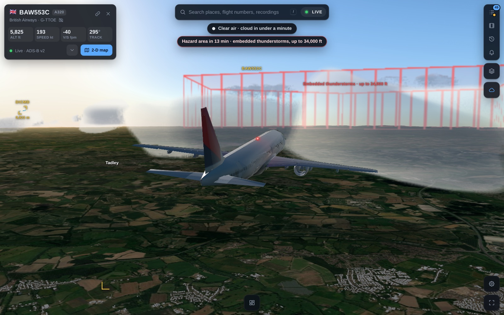
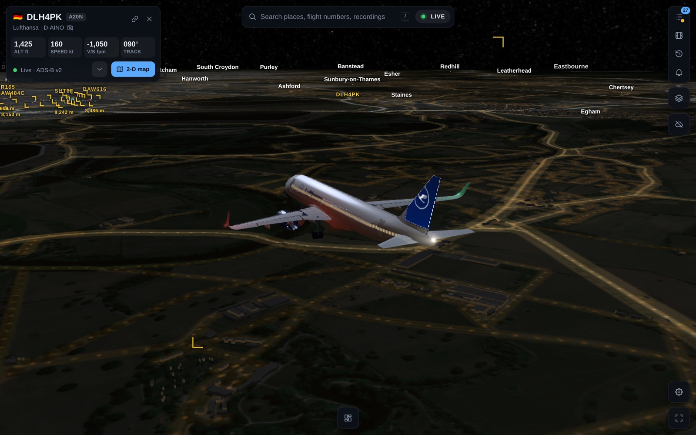
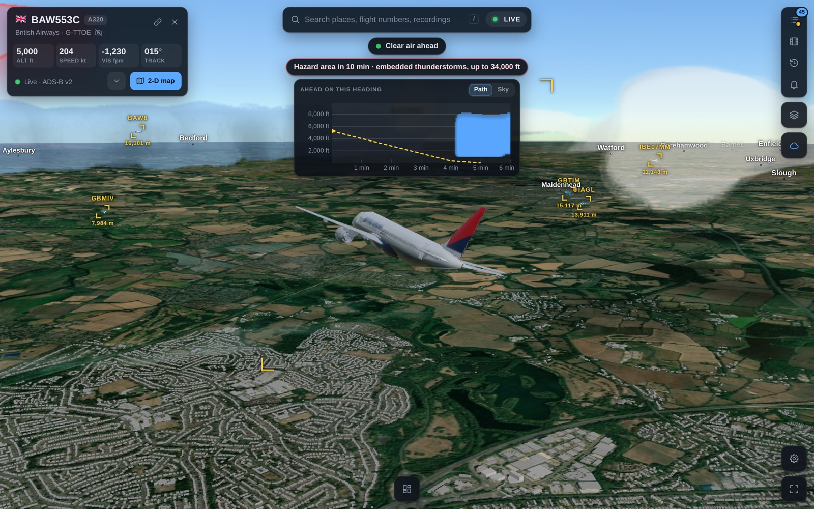
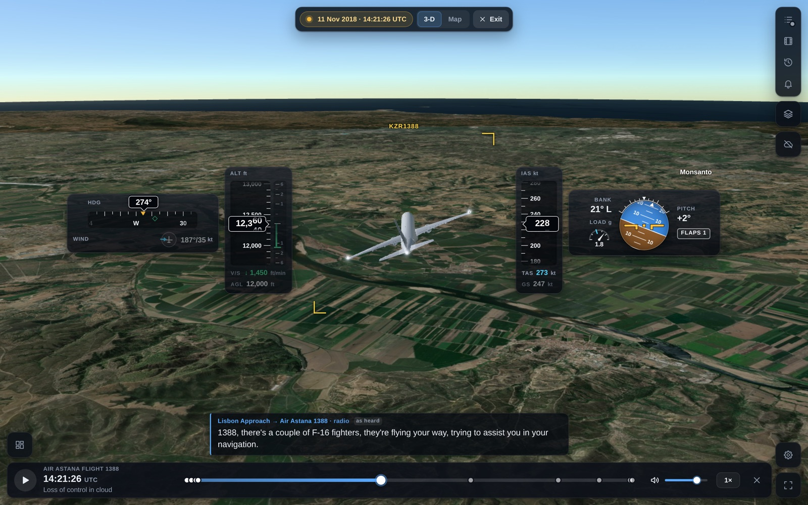
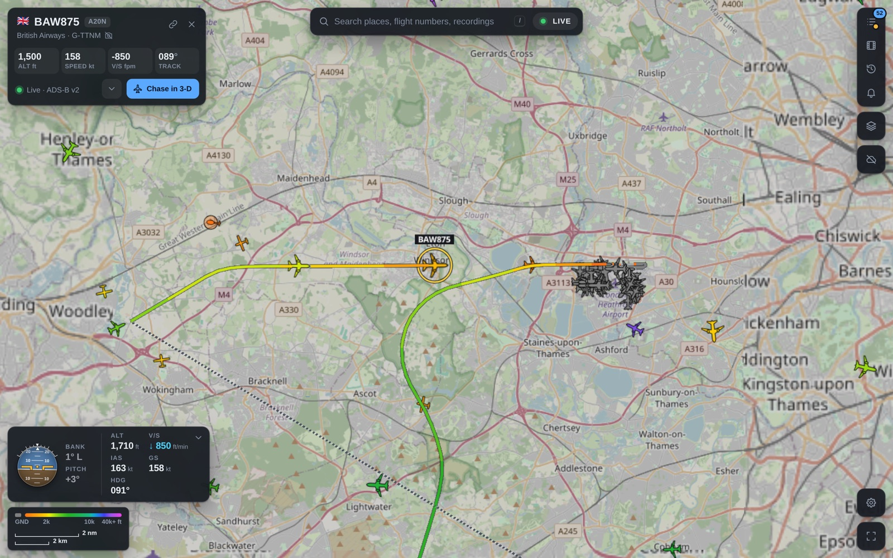

# Flight Chaser

Live air traffic on a 3-D globe. Pick an aircraft and fly behind it over real terrain, down to the runway.



<table>
<tr>
<td width="50%"><br><sub>On final: flight instruments, 3-D buildings, the traffic ahead</sub></td>
<td width="50%"><br><sub>Real terrain under every flight: the Inn valley, on the way into Innsbruck</sub></td>
</tr>
<tr>
<td><br><sub>Weather in the Sculpted look: clouds as bodies, a hazard area fenced off</sub></td>
<td><br><sub>The Natural look: cloud round the aircraft</sub></td>
</tr>
<tr>
<td><br><sub>Night: cabin and navigation lights, street lights below</sub></td>
<td><br><sub>The ahead strip: the next six minutes of the path, and the weather on it</sub></td>
</tr>
<tr>
<td><br><sub>A scenario: Air Astana 1388, its radio as captions, the timeline below</sub></td>
<td><br><sub>The live map: every aircraft in view, the selected one's path</sub></td>
</tr>
</table>

<sub>Screenshots of the app replaying recorded traffic at Heathrow, a synthetic approach into Innsbruck, and the Air
Astana 1388 scenario. The time of day is set with `?sun=`, the weather views show the demo sky (`?wxdemo=`), and the
close-ups hide the instrument cards with the layout button.</sub>

A personal, non-commercial project. **Entertainment only: not for navigation, ATC or any operational decision.**

## What it does

- **Live map.** Every aircraft in view from open ADS-B data, coloured by altitude. One search box finds airports,
  cities, countries and flights. A flight card shows the aircraft's photo, route and flown path. The Layers panel
  picks the map, its theme and what is drawn on it.
- **Chase view.** Follow one aircraft in 3-D: real terrain, sun and moon light for the time of day, city lights at
  night, 3-D buildings (`B` switches them, `X` makes them see-through), painted runways. Aircraft are type models in
  airline liveries, with landing gear, lights and glass-cockpit instruments. Nearby traffic is drawn too. The layout
  button arranges the instruments: drag, size or hide each card, switch a card to a smaller variant, or pick a
  ready-made layout (Compact, Stylistic, Detailed).
- **Weather.** Rain radar, airport reports and hazard areas on the map. In the chase, clouds, rain and storms are
  volumes round the aircraft, in three looks: Natural, Severity colours and Sculpted. The ahead strip shows the next
  six minutes of the aircraft's path and the weather on it. Over Europe, Africa and the Middle East the clouds stand
  where the Meteosat weather satellite sees them, with the cloud tops it measures. The Weather panel has the master
  switch (`W`); its button on the rail shows whether the weather is on.
- **History.** The map as it was at any time in the last 42 days, on a replay clock. Search a flight number
  (`W4 3257`) to see where it flies now and the days it flew, and replay any of them.
- **Recordings.** Record a flight with one button and replay it later. Import a flight from a file (KML, GPX, a
  Flightradar24 CSV, an ADS-B trace, an OpenSky track); download a recording as its own file or as KML.
- **Scenarios.** Reconstructed flights played back with a timeline, in 3-D or on the map. Captions come from the
  official record; where none exists they are marked "as heard". A scenario can play a voice recording in time with
  its captions. The recordings are not in the repository: [Scenarios](docs/scenarios.md) says how one is added and
  checked.
- **Alerts.** Emergency squawks worldwide and steep descents, with optional push to a phone.
- **Phone.** A layout for a phone, with the same features.

## Quick start

You need Node 24.2 or newer, npm and make.

```bash
git clone https://github.com/rg1989/FlightChaser.git
cd FlightChaser
make
```

`make` installs the dependencies the first time, starts the server with live traffic from adsb.fi and prints the link
(http://localhost:5173). Ctrl+C stops it. No account and no key is needed.

## Keys (optional)

Two free keys make the globe look better. On the first start a setup guide walks through both: where to sign up, what
to click, and a field that checks the key. Open it again from Settings → API keys → Setup guide.


| Key | Gives | Without it | Get it |
|---|---|---|---|
| ArcGIS API key | Esri World Imagery, 0.3 m at big airports | EOX Sentinel-2, 10 m | [location.arcgis.com](https://location.arcgis.com/sign-up/), free up to 2 million tiles a month |
| Cesium ion token | Cesium World Terrain | Re:Earth terrain | [ion.cesium.com](https://ion.cesium.com/signup/), free for personal use |

A key saved in the guide or in Settings stays in that browser and goes only to its own provider. You can also set
`VITE_ARCGIS_KEY` and `VITE_CESIUM_ION_TOKEN` in `.env.local`.

**Do not publish a build made with keys in `.env.local`.** Vite writes `VITE_*` values into the JavaScript bundle. For
a public deployment build without them and let each visitor add their own in Settings.

A third key is for the server, and is optional too: a free EUMETSAT account's consumer key and secret.

| Key | Gives | Without it | Get it |
|---|---|---|---|
| `EUMETSAT_KEY` and `EUMETSAT_SECRET` in `.env.local` | The chase's clouds from the weather satellite's raw products: the satellite's own pixels, no number read back from a picture's colour, and the newest frame a few minutes sooner | The same clouds from EUMETSAT's keyless pictures | An account at [eoportal.eumetsat.int](https://eoportal.eumetsat.int/), then the key and the secret at [api.eumetsat.int/api-key](https://api.eumetsat.int/api-key/). Accept the Meteosat data licence in the account |

The server alone uses this pair: it is never sent to the browser, never logged, and is not in the Settings dialog.
The app works the same without it. [Weather in the chase](docs/weather.md) says what it changes.

## Commands

| Command | What it does |
|---|---|
| `make` | Live traffic from adsb.fi, and the client |
| `make replay` | The same, replaying the newest recording in `data/recordings/`, or the bundled fixtures |
| `make live LIVE_SOURCE=adsblol` | Live from adsb.lol (needs `CONTACT`) |
| `npm run check` | Type-check and all tests |
| `npm run build` | The client, built into `dist/` |
| `npm run server` | The API server alone. It also serves `dist/`, on port 8787 |

## Configuration

Server settings are environment variables. `npm run server` and `make` read them from `.env.local`.
[`.env.example`](.env.example) lists them all. The ones you may want:

| Variable | Default | What it is |
|---|---|---|
| `ADSB_SOURCE` | `replay` (`make` sets `adsbfi`) | `adsbfi`, `adsblol`, `readsb` (your own receiver) or `replay` |
| `CONTACT` | none | An email or URL for the User-Agent. adsb.lol requires it |
| `PORT` | `8787` | The API server's port |
| `READSB_URL`, `READSB_COVERAGE` | | Your receiver's address and its coverage as `lat,lon,nm` |
| `EVENTS_DIR` | none (`make` sets `data/events`) | Where alerts keep their switch and log. Unset: no alerts |
| `NTFY_URL` | none | An [ntfy](https://ntfy.sh) topic that each new alert is pushed to. Treat it as a secret |
| `EUMETSAT_KEY`, `EUMETSAT_SECRET` | none | A EUMETSAT account's key and secret: the weather satellite's raw cloud products ([Keys](#keys-optional)). Secrets |

Useful links into the app: `?hex=<icao>&chase=1` chases an aircraft, `?scenario=<id>` plays a scenario,
`?hist=<unix seconds>` opens the past, `?setup=1` opens the setup guide.
Settings → Controls lists the keyboard shortcuts.

## Layout

| Path | What is in it |
|---|---|
| `client/` | The browser app: CesiumJS scene, UI, track smoothing, scenarios, history |
| `server/` | The API server: polls the flight data source, weather, history, alerts, recordings |
| `shared/` | Types and maths used by both |
| `public/` | Aircraft models, liveries, airports, scenario packages, map overlays |
| `tools/` | Scripts that build the data in `public/`, recorders and benchmarks |
| `harness/` | Development pages: each loads one part of the app alone (the sun, a model, the runways, the instruments), to work on it without live traffic |
| `third_party/` | Source of the GPL aircraft models |
| `.planning/` | Design notes and work plans, kept as the project's log |

No framework: TypeScript run by Node directly, Vite for the client, `node --test` for tests.

## More documentation

- [History](docs/history.md): flown paths and the replay of the past
- [Weather in the chase](docs/weather.md): the Weather menu, its looks and its check aids
- [Scenarios](docs/scenarios.md): the package format, and how to prepare one
- [Liveries and type models](docs/liveries.md): how to add an aircraft or an airline
- [Alerts](docs/anomaly-alerts.md): sources, rules and limits
- [Aircraft models](third_party/aircraft-models/README.md): licences and corresponding source
- [Data sources](docs/data-sources.md): what is read from where, and how the bundled data is rebuilt
- [Test fixtures](data/fixtures/README.md)

## Data sources and credits

- **Live aircraft:** [adsb.fi](https://adsb.fi) open data (personal, non-commercial use), the default.
  [adsb.lol](https://adsb.lol) for recordings and `LIVE_SOURCE=adsblol`: data © adsb.lol contributors,
  [ODbL 1.0](https://opendatacommons.org/licenses/odbl/1-0/).
- **The past:** adsb.lol's heatmap files and per-aircraft traces, the same ODbL 1.0 data.
- **Aircraft types in the past:** contains information from the
  [Mictronics aircraft database](https://github.com/Mictronics/aircraft-database), made available under the
  [ODC Attribution License](https://opendatacommons.org/licenses/by/1-0/).
- **Airports and runways:** [OurAirports](https://ourairports.com/data/) (public domain).
- **Airport weather and hazard areas:** the [aviationweather.gov](https://aviationweather.gov/data/api/) Data API.
- **Rain radar:** [RainViewer](https://www.rainviewer.com/api.html).
- **Weather model:** weather data by [Open-Meteo.com](https://open-meteo.com/),
  [CC BY 4.0](https://creativecommons.org/licenses/by/4.0/), free for non-commercial use.
- **Cloud positions and cloud tops:** Meteosat's cloud mask and cloud top height, © [EUMETSAT](https://www.eumetsat.int/)
  2026, read from [EUMETView](https://view.eumetsat.int/), or with your own EUMETSAT key from EUMETSAT's Data Store, and
  changed by Flight Chaser (moved for parallax and wind).
  Two conditions apply: no commercial or operational use, and no redistribution of the original data.
- **Places:** OurAirports and [GeoNames](https://www.geonames.org/)
  ([CC BY 4.0](https://creativecommons.org/licenses/by/4.0/)).
- **Borders and names in the chase:** [Natural Earth](https://www.naturalearthdata.com/) (public domain).
- **Street map and buildings:** © [OpenStreetMap](https://www.openstreetmap.org/copyright) contributors, with
  vector tiles from [OpenFreeMap](https://openfreemap.org/).
- **Aircraft photos:** [Planespotters.net](https://www.planespotters.net/). **Routes:** [adsbdb.com](https://www.adsbdb.com/).
- **City lights at night:** NASA VIIRS Black Marble.
- **Terrain and imagery:** Re:Earth terrain, EOX Sentinel-2 cloudless, Esri World Imagery, Cesium ion.
- **Aircraft models:** from FlightGear aircraft, GPL. See [third_party/aircraft-models](third_party/aircraft-models/README.md).

Each source has its own terms: see [docs/data-sources.md](docs/data-sources.md). Read them before you use
Flight Chaser for anything but personal use.

## Licence

The code is under the [MIT licence](LICENSE). That does not cover what the repository bundles from others:

- **Aircraft models** in `public/models/`: GPL-2.0 or GPL-3.0, from FlightGear aircraft. Their licences and source are
  in [third_party/aircraft-models](third_party/aircraft-models/README.md).
- **Fonts** in `public/fonts/`: SIL Open Font License, each with its licence file beside it.
- **Airline names and marks** on the liveries belong to their owners.
- **Data fetched while the app runs**: each source's own terms, listed above.

## Questions and bugs

Open an [issue](https://github.com/rg1989/FlightChaser/issues).
